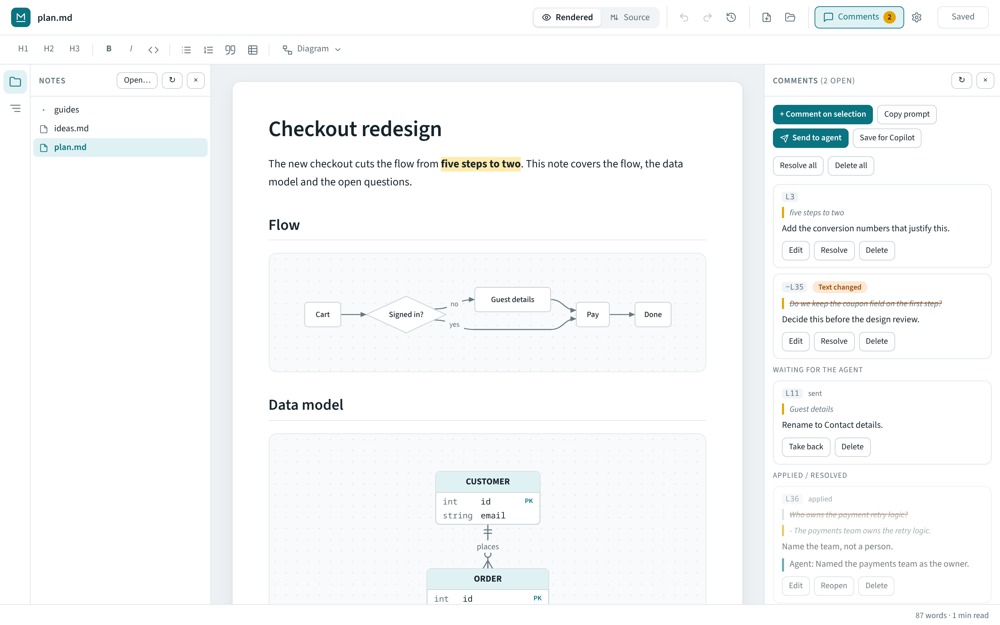
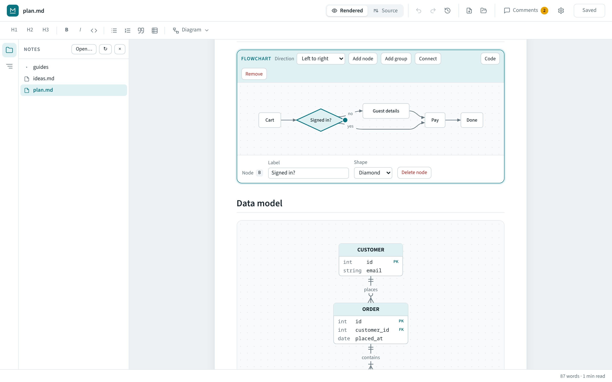
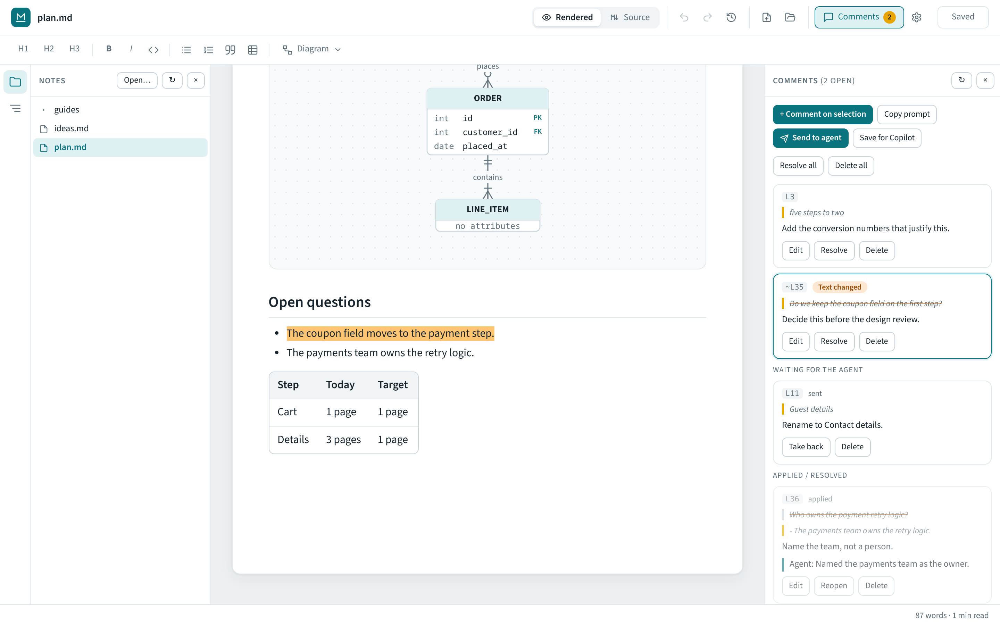
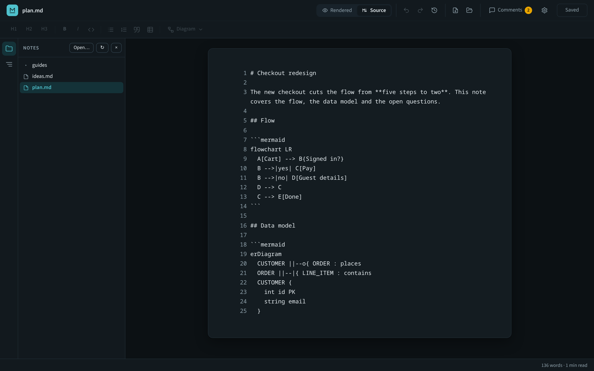
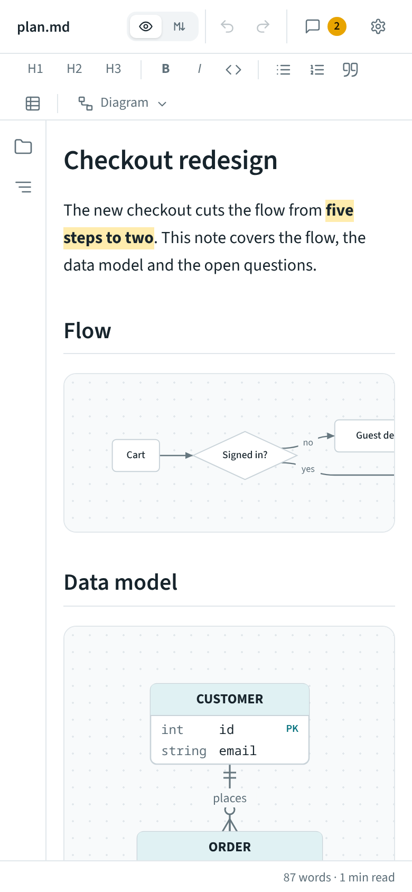

# Markline

A Markdown editor for people who review documents with a coding agent. You write in a rendered page, draw diagrams with the mouse, and leave comments on passages. A coding agent such as Claude Code or Codex picks the comments up, edits the file and replies in place. Copilot works through a prompt file. The desktop app (Tauri, Linux and Windows) also serves the same editor to your phone's browser.



## What it does

- **Write in the rendered view.** Headings, lists, tables, code and front matter are edited in place, and saved as plain Markdown. Switch to **Source** at any time: the caret keeps its place in the text and on the screen.
- **Edit Mermaid diagrams visually.** Flowcharts, architecture diagrams with groups, ER schemas and class diagrams. Click a node to rename it, change its shape or connect it. **Code** shows the Mermaid text.
- **Review with an agent.** Select text, add a comment, press **Send to agent**. The agent runs `markline poll`, edits the file and runs `markline reply`. Each reply shows under its comment, and clicking the comment jumps to the changed text.
- **Keep comments on track.** Comments are anchored to the quoted text, not to line numbers. If you rewrite the passage, the comment shows **Text changed** and points to the closest match.
- **Use it from your phone.** **Share** starts a small web server for one folder, protected by a token.
- **Work offline.** One binary, no Node server at runtime, light and dark themes.





<p>
  
  
</p>

## Install

### Prebuilt

Every push to `main` is built by GitHub Actions for Linux and Windows and published as its own tagged release (`v0.1.N`). The [latest release](https://github.com/diegogusava/markline/releases/latest) always points to the newest build; older versions stay under [Releases](https://github.com/diegogusava/markline/releases). The repo is private, so sign in to GitHub first.

| Platform | Asset |
|----------|-------|
| Arch Linux | `*.pkg.tar.zst` (`sudo pacman -U` it). Uses the system WebKit, so it works on Wayland. |
| Other Linux | `*.AppImage` (`chmod +x` it) or `.deb` |
| Windows | `*-setup.exe` or `.msi` |

If the release is missing, check the **Actions** tab for a failed build. Re-run it by pushing to `main` or using **Run workflow**.

### From source

Needs Rust, Node.js and npm. On Linux also `webkit2gtk-4.1` and `gtk3`.

```sh
npm install
node build-app.js              # assembles dist/ from editor/src
npx tauri build --no-bundle    # binary: src-tauri/target/release/markline
```

Run the Markdown conversion regression tests with `node --test`.

On Arch, `makepkg -si` uses the included `PKGBUILD`:

```sh
sudo pacman -S --needed webkit2gtk-4.1 gtk3 rust nodejs npm base-devel
```

Put the binary on your `PATH` for the CLI:

```sh
sudo install -m755 src-tauri/target/release/markline /usr/local/bin/
```

## Using the app

| Action | How |
|--------|-----|
| Show or hide the side panel | folder or outline icon on the left edge, or `Ctrl+\` |
| Jump to a heading | outline icon, then click the heading |
| Open a folder | **Open...** in the side panel (the last folder is remembered) |
| Insert a diagram | **Diagram** menu in the format bar |
| Text size | `Ctrl` + `-` / `=` / `0`, `Ctrl` + wheel, or **Settings** |
| Theme, fonts, line numbers, page width | **Settings** (gear icon, `Ctrl+,`) |
| Undo, redo, history | arrow icons and the clock icon, or `Ctrl+Z` / `Ctrl+Shift+Z` |
| Indent | `Tab` / `Shift+Tab`: nests list items, moves between table cells (the last cell adds a row), indents code and Source lines |
| Full path of the file | under the file name; click it to copy |
| Comment on a passage | select text, then `Ctrl+Alt+M` or click the Comment bubble |

Comments are highlighted in Rendered view and listed in the side panel with line numbers. They are anchored to the quoted text, so they survive edits elsewhere. When the quoted text itself was rewritten, the comment shows **Text changed** and a line like `~L35`: clicking it selects the closest match, found from the text that stood around the quote.

### Review with Copilot

- **Copy prompt** puts the commented passages and their open comments on the clipboard, without the rest of the document. Paste it into Copilot Chat and apply the passages it returns.
- **Save for Copilot** saves the file and its comments file. Copy `prompts/apply-comments.prompt.md` to your project's `.github/prompts/`, open the `.md` in VS Code and run `/apply-comments` in agent mode. Copilot edits the file and marks comments `applied`. Click reload in the Comments panel to pick up the changes.

## Use it from your phone

1. Open the app, then **Files > Open...** and pick your notes folder.
2. Click **Share** (phone icon), keep **Allow other devices** ticked, press **Start sharing**.
3. Open the link under **On your phone** in your phone's browser (same Wi-Fi, or Tailscale away from home).

Tick **Start sharing when the app starts** to keep it on. The link stays the same between restarts.

Security:

- The phone reaches only the shared folder, only `.md`, `.markdown` and `.txt` files plus their comments files, and needs the link's token.
- The connection is plain HTTP. Use a network you trust, or Tailscale.
- Sharing stops when you close the app.

## Command line

The app binary doubles as a CLI. Run `markline --help` for usage.

```sh
markline FILE.md                  # open the desktop app
markline serve --root ~/notes --lan   # headless server, runs in the foreground
markline open notes/plan.md       # start a headless server if none runs, print the link
markline open notes/plan.md --lan # same, reachable from your phone
markline poll                     # block until "Send to agent" is pressed; print the comments
markline reply --batch ID --comment C2 --lines 14-16 "what I changed"
markline reply --batch ID "summary for every comment of the batch"
markline status
markline stop
```

Flags: `--root DIR`, `--port N` (default 8080), `--lan`, `--token T`, `--no-open`, `--file F`, `--timeout SECS`, `--json`, `--resolved`, `--comment ID`, `--lines A-B`.

`open` and `poll` find the running server by themselves, whether it is the app's Share server or a headless one.

### Agent review loop

1. In the browser or the desktop app, select text, add comments, then press **Send to agent** in the Comments panel.
2. The agent runs `poll`, which prints each comment with its ID. It edits the file in place, then replies once per comment: `reply --batch ID --comment C2 --lines 14-16 "..."`. `--lines` are the lines that now hold the edited passage. Markline re-anchors the comment to that text and keeps the old quote, struck through, above it.
3. The page reloads about 2 seconds after the save (unless you have unsaved edits) and shows the reply under each comment: *Waiting for the agent*, then *Applied*. Click an applied comment to jump to the change.

On a touch screen, a Comment bubble appears when you select text.

Teach your agent the loop by copying `skills/markline-review/SKILL.md` to `.claude/skills/markline-review/SKILL.md` (Claude Code), or paste its steps into `AGENTS.md` (Codex and others).

On Windows the release app has no console, so CLI output is not shown. Use Linux or macOS for the agent loop.
